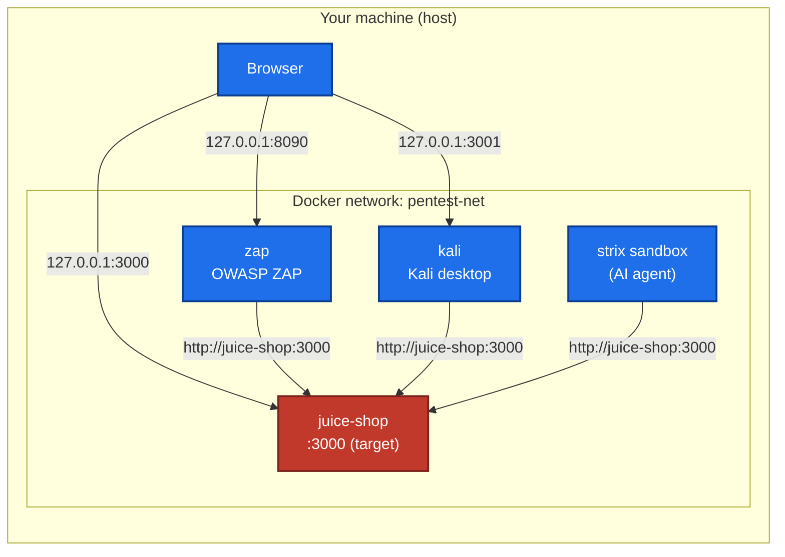
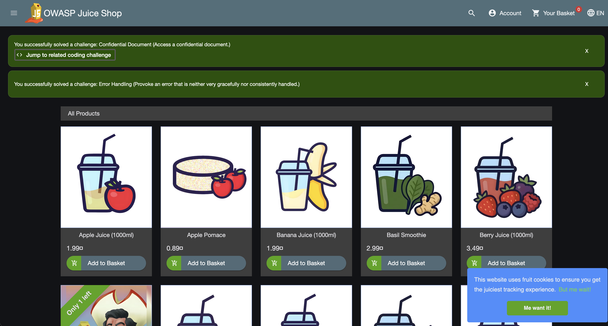
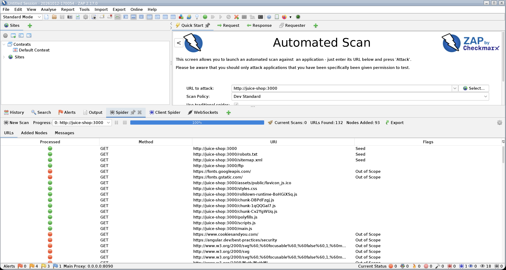
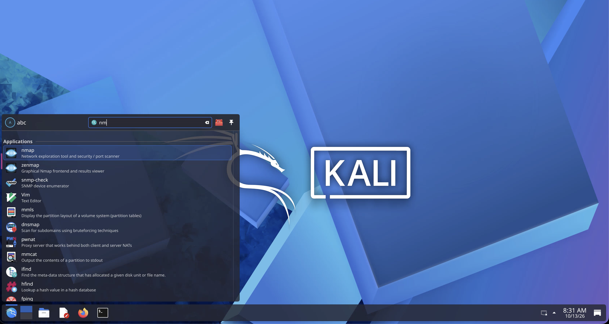

# Local Web Security Lab — Juice Shop × Strix / ZAP / Kali

A self-contained, local lab for practicing web application security testing against [OWASP Juice Shop](https://owasp.org/www-project-juice-shop/) (an intentionally vulnerable learning app), using the attacker tooling of your choice: the AI agent [Strix](https://github.com/usestrix/strix), [OWASP ZAP](https://www.zaproxy.org/), or a full [Kali Linux](https://www.kali.org/) desktop in your browser.

Everything runs in Docker on your own machine. The target is published on `127.0.0.1` only, so nothing is exposed to any external network.

> [!WARNING]
> Juice Shop is **intentionally vulnerable**. Keep it bound to `127.0.0.1` and never expose it to a network. Only run these tools against this local target that you own and control — not against any system you are not authorized to test.

## Architecture

All containers share one Docker network, `pentest-net`. Containers talk to each other **by container name**, so attacker tools reach the target at `http://juice-shop:3000` — not `127.0.0.1`. Your host browser reaches each GUI through a `127.0.0.1`-only published port.



> [!IMPORTANT]
> When you type a target into ZAP, Kali, or Strix, use **`http://juice-shop:3000`**. Using `127.0.0.1` or `localhost` from inside a container points at the container itself, so the scan finds nothing. (Strix is the exception — it auto-rewrites `localhost` to reach the host.)

## Choose your attacker tool

| Tool | What it is | Weight | Cost | Start |
| --- | --- | --- | --- | --- |
| **OWASP ZAP** | Scanner with a browser UI. Point-and-click active/passive scans. | Light | Free | `docker compose --profile zap up -d` |
| **Kali Linux** | Full Kali desktop in your browser (ZAP, Burp, nmap, Firefox…). | Heavy | Free | `docker compose --profile kali up -d` |
| **Strix** | AI agent that finds and proves vulns autonomously. | — | Paid (LLM) | `./run-pentest.sh` |

ZAP and Kali are rule-based and free — scan as often as you like. Strix is smarter but calls an LLM heavily, so each scan costs real money. Start with ZAP.

## Target only

```bash
docker compose up -d                 # start Juice Shop
open http://127.0.0.1:3000           # browse it
```



## Option A — OWASP ZAP (recommended first)

```bash
docker compose --profile zap up -d
open http://127.0.0.1:8090/zap/      # ZAP in your browser
```

In ZAP's **Automated Scan**, set the target to `http://juice-shop:3000` and run it. No VM, no install — the ZAP GUI is streamed to your browser.



## Option B — Kali Linux desktop

```bash
docker compose --profile kali up -d
open http://127.0.0.1:3001           # Kali desktop in your browser
```

A full Kali XFCE desktop runs in the container and is streamed to your browser over noVNC. Inside it you get ZAP, Burp Suite, nmap, Firefox and more. Point any of them at `http://juice-shop:3000`. The first start is slow (large image + tool install) and the desktop is heavier than ZAP alone.

> [!NOTE]
> First boot downloads a large image and installs the tools (Burp Suite, ZAP, nmap), so it takes several minutes before the desktop responds on port 3001. Watch progress with `docker logs -f kali`. Make sure Docker has **~10 GB of free disk**, or the image extraction fails with "no space left on device"; free space with `docker image prune` and by removing stopped projects you can rebuild.



## Option C — Strix (AI agent, paid)

```bash
cp .env.example .env                 # add your LLM API key
./run-pentest.sh -m quick --max-budget 5
```

See [Cost](#cost-strix-only) below. Strix is the only option here that costs money.

## Reconnaissance / OSINT

In a **real** engagement, penetration testing starts long before any scanner runs. The first phase is reconnaissance: gathering open-source intelligence (OSINT) about the target — domains, subdomains, employees, leaked credentials, technologies, exposed services. Good recon shapes everything that follows.

This lab has no real recon surface (the target is a local app you already own), so OSINT is included here as **background knowledge**, not something to run against anyone. Study it, then apply it only to targets you are authorized to assess.

### Frameworks & reference maps

| Resource | What it gives you |
| --- | --- |
| [OSINT Framework](https://osintframework.com/) | A large, categorized map of OSINT sources and tools. The classic starting point. |
| [OpenOSINT](https://github.com/OpenOSINT/OpenOSINT) | An AI-driven OSINT agent that orchestrates ~20 investigation tools via a CLI, REPL, web UI and MCP server. |
| [OWASP WSTG — Information Gathering](https://owasp.org/www-project-web-security-testing-guide/stable/4-Web_Application_Security_Testing/01-Information_Gathering/) | The reconnaissance phase of the official Web Security Testing Guide. |

### Hands-on recon tools

| Tool | Purpose | In Kali |
| --- | --- | --- |
| [OWASP Amass](https://github.com/owasp-amass/amass) | Attack-surface mapping and subdomain enumeration | installable |
| [theHarvester](https://github.com/laramies/theHarvester) | Emails, subdomains and names from public sources | bundled |
| [Recon-ng](https://github.com/lanmaster53/recon-ng) | Modular web-reconnaissance framework | bundled |
| [Spiderfoot](https://github.com/smicallef/spiderfoot) | Automated OSINT collection with a web UI | installable |

> [!CAUTION]
> OSINT and recon tools query real third parties and real people's data. Only use them within an authorized engagement and within the law. Nothing in this repo should be pointed at a target you do not own or have written permission to test.

## Methodology references

- **[OWASP Web Security Testing Guide](https://owasp.org/www-project-web-security-testing-guide/)** — the standard testing methodology, phase by phase.
- **[OWASP Top 10](https://owasp.org/www-project-top-ten/)** — the most critical web app risks.
- **[Juice Shop companion guide](https://pwning.owasp-juice.shop/)** — challenges and walkthroughs for this exact target.

## Teardown

```bash
docker compose --profile zap --profile kali down   # stop everything
docker ps                                          # verify
```

## Files

| File | Purpose |
| --- | --- |
| [docker-compose.yml](docker-compose.yml) | Target + ZAP + Kali, selected via profiles |
| [run-pentest.sh](run-pentest.sh) | Loads `.env`, starts the target, runs Strix |
| [.env.example](.env.example) | Template for Strix's LLM config (you add the key) |
| [.gitignore](.gitignore) | Excludes `.env` and scan results |

## Cost (Strix only)

Strix itself is free, but it pays an LLM per token and calls it heavily. Reported real-world numbers for a Claude Sonnet run:

| Scan | Rough cost |
| --- | --- |
| `quick` | about $15–20 |
| `deep` | $50 and up |

A short run can consume millions of tokens in minutes, which can even trip a provider's abuse detection and auto-disable your key. Always pass `--max-budget`, and note it is best-effort and can overshoot. ZAP and Kali cost nothing.

## Security notes

- `.env` holds your real API key. **Never commit it** (already in `.gitignore`).
- All ports are bound to `127.0.0.1`. Don't change them to `0.0.0.0` or a bare `PORT:PORT` — that would expose a vulnerable app and attacker tooling to your whole network.
- Only use these tools against targets you are authorized to test. This repo is scoped to the local Juice Shop instance on your own machine.
