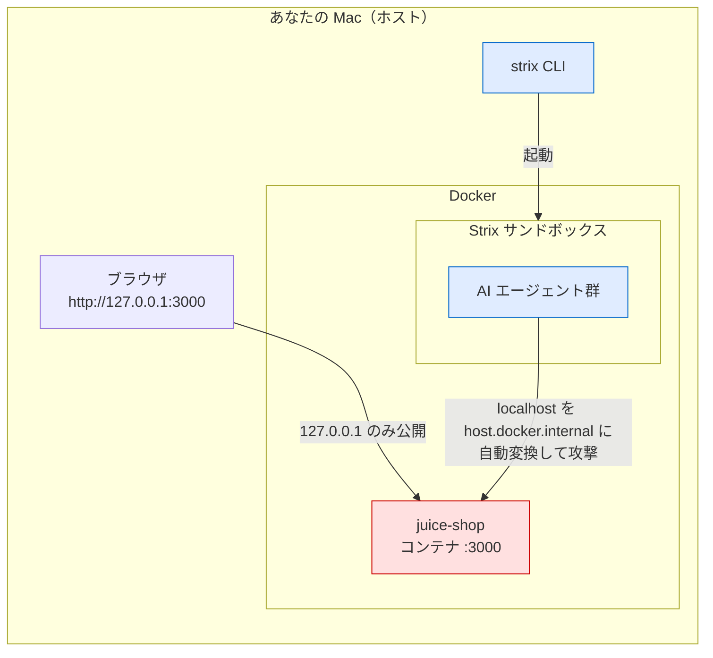

# Strix × OWASP Juice Shop ローカル・ペンテスト環境

ローカルの Docker 上で動く [OWASP Juice Shop](https://owasp.org/www-project-juice-shop/)（学習用のわざと脆弱な Web アプリ）を、AI ペンテストエージェント [Strix](https://github.com/usestrix/strix) で自分の PC だけで安全に診断するための環境です。

> [!WARNING]
> Juice Shop は**意図的に脆弱**に作られたアプリです。外部ネットワークには絶対に公開しないでください。この構成はポートを `127.0.0.1`（自分の PC のみ）に限定しているため安全です。自分が管理するこのターゲット以外に Strix を向けないでください。

## 構成図



ポイントは2つです。

- **Juice Shop は `127.0.0.1:3000` のみに公開**。同じ Wi-Fi の他端末からも届かず、外部にも晒されません。
- **Strix はサンドボックス内から攻撃**するが、`localhost` / `127.0.0.1` を自動で `host.docker.internal` に書き換えるため、ループバック限定のターゲットにも到達できます。

## 前提

| 必要なもの | 確認コマンド |
| --- | --- |
| Docker（起動中） | `docker ps` |
| Strix CLI | `strix --version` |
| LLM の API キー | Anthropic / OpenAI などお好みのプロバイダ |

Strix 未インストールの場合は `uv tool install strix-agent`（または `pipx install strix-agent`）で入ります。

## セットアップ

### 1. LLM の設定（`.env`）

`.env.example` をコピーして、使うプロバイダのキーを書きます。

```bash
cp .env.example .env
# .env を開いて LLM_API_KEY を自分のキーに書き換える
```

`.env` は [.gitignore](.gitignore) 済みなので Git には載りません。

### 2. 実行

```bash
./run-pentest.sh -m quick        # まずはクイックスキャン
./run-pentest.sh                 # 既定（deep）でじっくり
./run-pentest.sh --instruction "SQLiとXSSを重点的に"
```

スクリプトが Juice Shop の起動 → 応答待ち → Strix 実行までを自動で行います。`.env` も自動で読み込みます。

手動で Strix だけ回す場合:

```bash
strix --target http://localhost:3000 -m quick
```

結果は `strix_runs/<run-name>/` に保存されます（Git からは除外）。

## 片付け

```bash
docker compose down      # Juice Shop を停止・削除
docker ps                # 稼働確認
```

## ファイル構成

| ファイル | 役割 |
| --- | --- |
| [docker-compose.yml](docker-compose.yml) | Juice Shop を `127.0.0.1:3000` で起動 |
| [run-pentest.sh](run-pentest.sh) | `.env` 読み込み → 起動 → Strix 実行 |
| [.env.example](.env.example) | LLM 設定のテンプレート（キーは各自記入） |
| [.gitignore](.gitignore) | `.env` とスキャン結果を除外 |

## セキュリティ注意事項

- `.env` に実際の API キーを入れます。**絶対にコミットしないでください**（`.gitignore` 済み）。
- `docker-compose.yml` の `127.0.0.1:3000:3000` を `3000:3000` に変えると LAN 全体に脆弱アプリを晒すことになります。変更しないでください。
- Strix は自分が許可を得たターゲットにのみ使用してください。本リポジトリの用途は自分の PC 内の Juice Shop に対する学習・検証に限られます。
