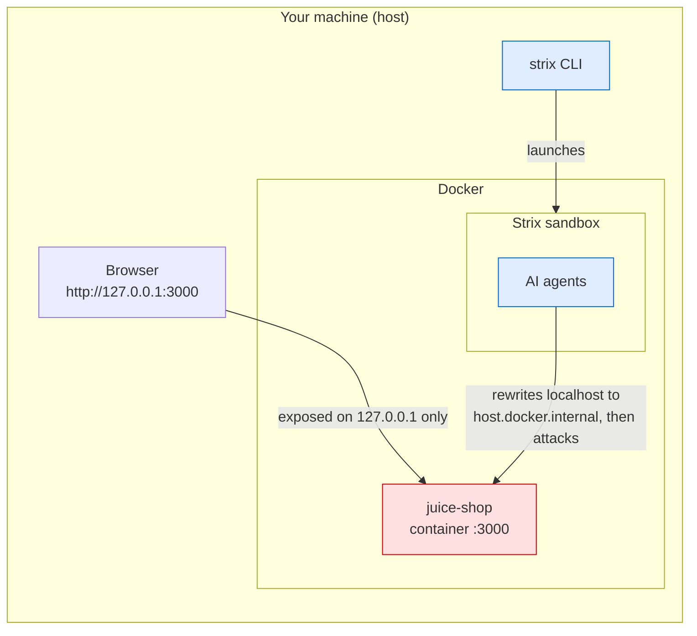

# Strix × OWASP Juice Shop — Local Pentest Environment

A self-contained setup to run the AI penetration-testing agent [Strix](https://github.com/usestrix/strix) against [OWASP Juice Shop](https://owasp.org/www-project-juice-shop/) (an intentionally vulnerable learning app) entirely on your own machine, safely.

> [!WARNING]
> Juice Shop is **intentionally vulnerable**. Never expose it to any external network. This setup binds the port to `127.0.0.1` (your machine only), so it stays safe. Only point Strix at this target that you own and control.

## Architecture



Two key points:

- **Juice Shop is published on `127.0.0.1:3000` only.** It is unreachable from other devices on the same Wi-Fi and from the internet.
- **Strix attacks from inside its sandbox**, but it automatically rewrites `localhost` / `127.0.0.1` to `host.docker.internal`, so it can still reach a loopback-only target.

## Prerequisites

| Requirement | Check |
| --- | --- |
| Docker (running) | `docker ps` |
| Strix CLI | `strix --version` |
| An LLM API key | Anthropic / OpenAI / etc. |

If Strix is not installed yet: `uv tool install strix-agent` (or `pipx install strix-agent`).

## Setup

### 1. Configure the LLM (`.env`)

Copy the example and fill in your provider's key.

```bash
cp .env.example .env
# edit .env and set LLM_API_KEY to your own key
```

`.env` is listed in [.gitignore](.gitignore), so it never gets committed.

### 2. Run

```bash
./run-pentest.sh -m quick        # quick scan first
./run-pentest.sh                 # default (deep) scan
./run-pentest.sh --instruction "Focus on SQLi and XSS"
```

The script starts Juice Shop, waits until it responds, then runs Strix. It loads `.env` automatically.

To run Strix by hand:

```bash
strix --target http://localhost:3000 -m quick
```

Results are saved to `strix_runs/<run-name>/` (excluded from git).

## Teardown

```bash
docker compose down      # stop and remove Juice Shop
docker ps                # verify
```

## Files

| File | Purpose |
| --- | --- |
| [docker-compose.yml](docker-compose.yml) | Runs Juice Shop on `127.0.0.1:3000` |
| [run-pentest.sh](run-pentest.sh) | Loads `.env`, starts the target, runs Strix |
| [.env.example](.env.example) | Template for LLM config (you add the key) |
| [.gitignore](.gitignore) | Excludes `.env` and scan results |

## Security notes

- `.env` holds your real API key. **Never commit it** (already in `.gitignore`).
- Changing `127.0.0.1:3000:3000` to `3000:3000` in `docker-compose.yml` would expose a vulnerable app to your whole LAN. Don't.
- Only use Strix against targets you are authorized to test. This repo is scoped to the local Juice Shop instance on your own machine, for learning and validation.
